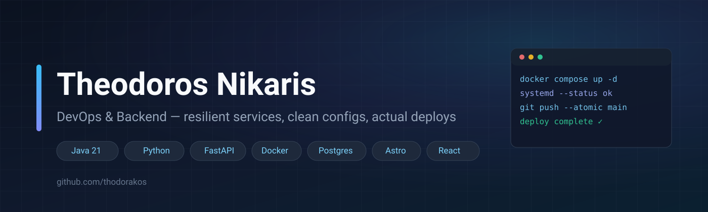

  

## About

DevOps-first engineer with backend experience. My natural habitat is the
deploy pipeline: **containerized services (Docker/Compose), Kubernetes with
Helm charts, and Cilium for eBPF networking** — running on Linux they actually
care about. I ship Spring Boot / FastAPI backends the way I'd like to inherit
them: configs that fail loudly when a secret is missing, atomic pushes, and
histories that have never had anything to hide.

Currently shipping **[AEGIS](https://github.com/thodorakos/aegis)** — a live
natural-disaster monitor for Greece that ingests NASA EONET into PostGIS and
surfaces geo-flagged events on a React globe.

- What I care about: reproducible builds, sane `.env` boundaries, boring deploys, observable clusters
- On the ops side: Docker → Kubernetes (Helm) → Cilium (CNI, eBPF), GitHub Actions CI/CD, systemd & Nginx
- On the dev side: Spring Boot (Java 21), FastAPI (Python), PostgreSQL incl. PostGIS
- How I work: small audited increments, honest READMEs, infrastructure documented in the repo

## The toolbox

**Ops — where I start every project**

**Backend**

**Frontend**

## Selected work

| Project | What it does | Built with |
|---|---|---|
| [**aegis**](https://github.com/thodorakos/aegis) | Live natural-disaster monitor for Greece — NASA EONET ingest, PostGIS geo-flagging, globe visualization | React · Vite · shadcn/ui · FastAPI · PostGIS |
| [**rate_my_csd**](https://github.com/thodorakos/rate_my_csd) | Course-rating platform with a public facing site and a staff dashboard | Spring Boot (Java 21) · PostgreSQL · Astro + React |
| [**private_dining**](https://github.com/thodorakos/private_dining) | Restaurant reservation system — JWT auth, booking lifecycle, admin flows | React · Spring Boot · PostgreSQL |
| [**gym-booking**](https://github.com/thodorakos/gym-booking) | Gym booking interface with an admin dashboard (prototype admin data) | Astro · Vue · PrimeVue · Docker |
| [**diavgeia**](https://github.com/thodorakos/diavgeia) | Greek transparency-data dashboard experiment | FastAPI · Astro · PostgreSQL |
| [**coffee_app**](https://github.com/thodorakos/coffee_app) | Coffee discovery: quiz, education, browser-local favorites | Astro · React |
| [**spotify_shutdown**](https://github.com/thodorakos/spotify_shutdown) | Utility that schedules a Windows shutdown when the current Spotify track ends | Python · Spotify API (OAuth) |

## The numbers

  
  

  

  <picture>
    <source media="(prefers-color-scheme: dark)" srcset="https://raw.githubusercontent.com/thodorakos/thodorakos/output/github-contribution-grid-snake-dark.svg" />
    
  </picture>

  If the snake hasn't slithered yet, the deploy is running — check
  <a href="https://github.com/thodorakos/thodorakos/actions">Actions</a>.

